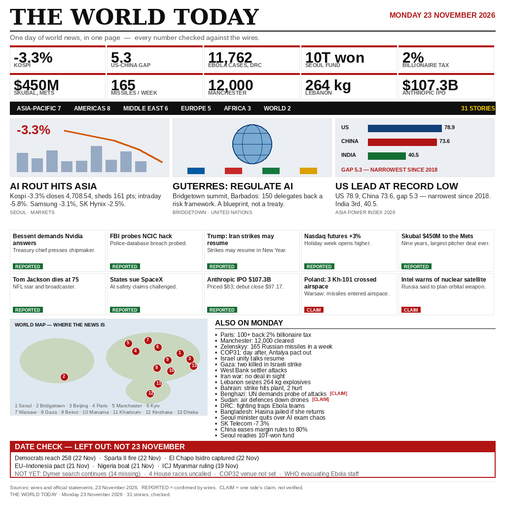

[](https://make.fun/bounty/news-image-20261123?utm_source=github&utm_medium=readme&utm_campaign=news-image-20261123)
[](https://make.fun/bounty/news-image-20261123/leaderboard?utm_source=github&utm_medium=readme&utm_campaign=news-image-20261123)
[](https://make.fun/bounty/news-image-20261123?utm_source=github&utm_medium=readme&utm_campaign=news-image-20261123)

# THE WORLD TODAY — Monday 23 November 2026

One day of world news in one image: 31 stories from 23 November 2026,
led by a big number grid — the Kospi's −3.3% AI rout, the US–China power
gap at a record-low 5.3, and the Guterres call to regulate AI before it
is too late.



## How to run

```sh
python3 main.py
```

`main.py` is stdlib-only: it validates `entry.png` (PNG header, chunk
CRCs, 1024×1024, ≤1 MiB) and writes the checked bytes to
`$MAKEFUN_OUTPUT_DIR/entry.png`.

## Facts (all 23 November 2026)

- AI rout hits Asia: Kospi −3.3%, closes 4,708.54, sheds 161 pts,
  intraday −5.8%; Samsung −3.1%, SK Hynix −2.5%.
- Guterres at the Bridgetown summit, Barbados: 150 delegates back an
  AI risk framework — a blueprint, not a treaty.
- Asia Power Index 2026: US 78.9, China 73.6, gap 5.3 — narrowest
  since 2018; India 3rd at 40.5.
- Anthropic IPO: $107.3B, priced at $83/share on 19 Nov, debut close
  $97.17.
- The red DATE CHECK box lists only stories that are NOT from 23 Nov
  (Democrats reach 258, Sparta II fire, El Chapo Isidro captured,
  EU–Indonesia pact, Nigeria boat, ICJ Myanmar ruling) and items not
  yet decided.
